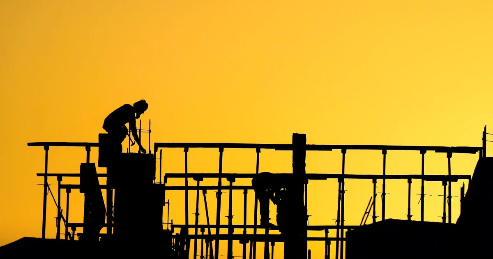

<div align="center">

# Seca Obra

**A bold, cinematic landing page for a waterproofing company.**
Built to turn visitors into WhatsApp quote requests.




</div>

> **Portfolio project.** The company is fictional ("Seca Obra" is a placeholder name). Phone numbers, social links and details are samples, and the page labels them as such.

## Highlights

- **Cinematic, non-3D hero** with scroll-driven reveals and masked transitions.
- **WhatsApp quote button** with a prefilled message (`wa.me` link).
- **Service sections** for roofs and slabs, basements, tanks, facades and parking decks.
- **Four-step process** (inspection, preparation, application, finishing).
- **FAQ** answering the most common doubts about moisture and waterproofing.
- **Real photography** from Pexels, optimized by a build script and fully credited in [`CREDITS.md`](CREDITS.md).
- **Mobile first** and accessible, with `prefers-reduced-motion` respected.
- **Almost no JavaScript** shipped beyond animation, so it stays fast on phones.

## Tech stack

| Area | Choice |
|---|---|
| Framework | Astro 7, static output |
| Motion | GSAP + ScrollTrigger, Lenis smooth scroll |
| Styling | Plain modern CSS with custom properties |
| Fonts | Schibsted Grotesk + Instrument Serif (Fontsource) |
| Icons | lucide-static |
| Images | `sharp` pipeline (`photos:fetch`, `photos:build`) |
| Hosting | Cloudflare Pages |

## Getting started

```bash
npm install
npm run dev        # http://localhost:4321
```

| Command | What it does |
|---|---|
| `npm run dev` | Start the dev server |
| `npm run build` | Build the static site into `dist/` |
| `npm run preview` | Preview the production build |
| `npm run photos:fetch` | Download the source photos listed in `scripts/photos.sources.json` |
| `npm run photos:build` | Generate optimized responsive images |

## Project structure

```
src/
  pages/        index.astro (single-page site)
  components/   Icon, Picture
  layouts/      Base layout
  data/         Site info and photo metadata
  scripts/      Motion
  styles/       Tokens and global CSS
scripts/        Photo pipeline
```

The design system is in [`DESIGN.md`](DESIGN.md) and the scope in [`BRIEF.md`](BRIEF.md). The page is in Brazilian Portuguese.

## Author

Built by **Eduardo Sousa**, web developer in Belo Horizonte, Brazil.

[Portfolio](https://oeduardosousa.com) · [LinkedIn](https://www.linkedin.com/in/eduardo-sousa-528b77334) · [GitHub](https://github.com/oeduardosousa)
